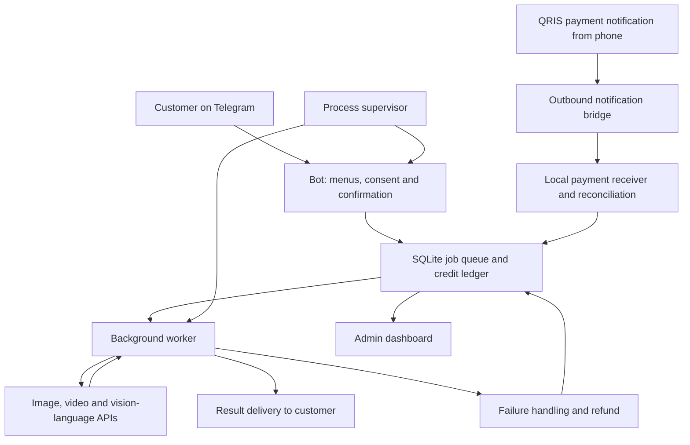
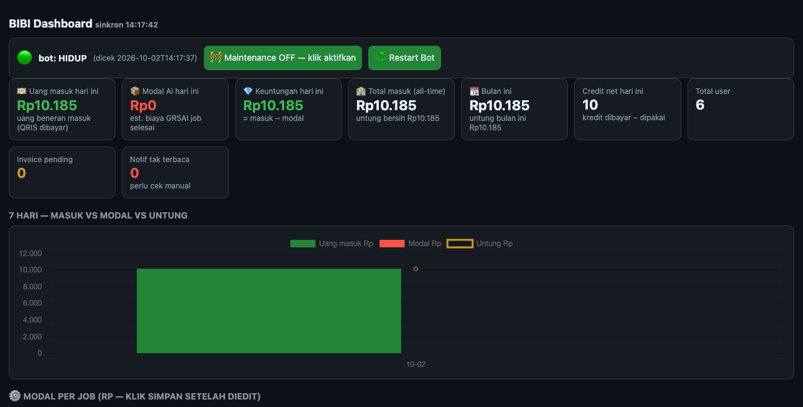

# AIGC BIBI | Applied AI & Automation Portfolio

**Rico DwiThama · AI Automation / Applied AI · Enterprise UAT background**

AIGC BIBI is a Telegram-based service that connects generative AI with a practical customer workflow: request an output, pay for credits, submit a job and receive the result.

This repository is a **public engineering case study**, not the production application. Production source, payment configuration, credentials, customer records and customer photos are deliberately excluded.

[Try the bot](https://t.me/AIGCBIBIBOT) · [LinkedIn](https://www.linkedin.com/in/rico-dwithama-b9863056/)

## Why this project matters

An AI API call is only one part of a usable product. BIBI also needs job tracking, payment reconciliation, credit accounting, failure recovery, delivery and operational visibility.

The project demonstrates the connection between **business requirements, AI API integration and a testing mindset**—building on my system-testing and UAT experience at PT Prudential Life Assurance (2013–2022).

## Product capabilities

- Old-photo restoration.
- Product photo to affiliate video, configured for 1080p output.
- Photo animation.
- Vision-assisted affiliate captions and marketing text.
- AI-generated 4K posters.

Motion control is a separate catalogue entry under maintenance, not an available feature in this case study.

## My role and development approach

I own the product direction, customer workflow, pricing decisions and acceptance criteria. Development is AI-assisted: I orchestrate an AI coding agent for implementation, debugging and verification, and review the resulting product against business needs.

This is an **AI integration and automation project**, not a claim of training foundation models or writing all code unaided. I am interested in AI Automation, Applied AI and AI Operations opportunities where workflow design, testing and practical delivery matter.

## Architecture

This is a high-level diagram, not a disclosure of deployment addresses or security configuration.

## Engineering decisions and business value

### 1. Asynchronous AI jobs

A background queue separates chat interactions from long-running generation. Jobs move through processing and delivery states rather than relying on one uninterrupted chat request.

**Value:** customers can use a simple interface while slower AI tasks are tracked independently.

### 2. Credit accounting and failure recovery

The implementation uses conditional credit deductions and idempotent refund handling. Failed generation should not silently consume a customer's balance. The project also includes invoice reconciliation and retry/sweeper logic.

**Value:** protects customer trust and reduces manual payment support. These mechanisms reduce known failure modes; they are not a guarantee that the system is bug-free.

### 3. QRIS notification-based reconciliation

Unique-amount invoices are matched with payment notifications relayed from an Android phone. A local receiver reconciles the event and credits the account.

**Observed milestone:** one external customer's Rp10,185 payment was credited as 10 credits, with approximately 42 seconds between invoice creation and the recorded credit event. This is a single observation, not an average latency, an SLA, or evidence of an international customer.

**Trade-off:** the workflow depends on the phone, notification delivery and network availability. It is not a bank-grade settlement integration or a replacement for a payment gateway at scale.

### 4. Operational dashboard

The admin interface provides payment receipts, configured AI cost estimates, usage rankings, pending invoices and maintenance/restart controls.

**Value:** makes service usage and operating costs visible rather than treating every AI request as an opaque expense.

*Actual early-stage dashboard capture, October 2026. Cropped to remove customer-ID tables and internal cost configuration; no figures were fabricated. Labels are in Indonesian. The prototype's “profit” cards are cash receipts minus tracked AI costs—not audited net profit or earned revenue. Unused prepaid credits, overhead, taxes and other costs are not fully represented.*

### 5. Consent and operational safeguards

Photo-promotion use has an explicit opt-in flow. Operational tooling includes a process supervisor and a group-moderation worker with a single-instance lock.

**Value:** separates promotional permission from the core service and reduces duplicate-worker conflicts.

## Skills demonstrated through the project

- **Applied AI:** image/video API integration, vision-language prompting, asynchronous generation and result delivery.
- **Automation:** Telegram workflows, API orchestration, scheduled work and notification bridges.
- **Implementation stack:** Python, FastAPI, SQLite and python-telegram-bot, developed with AI coding assistance.
- **Reliability:** job-state handling, conditional updates, idempotency, retry/reconciliation and operational monitoring.
- **Quality:** acceptance criteria, failure-path testing, bug investigation and business-rule validation.
- **Product thinking:** service pricing, provider-cost analysis, customer consent and a usable end-to-end workflow.

Related portfolio work includes local video rendering with Python, Pillow, FFmpeg and TTS, plus scheduled content publication. That is a separate workflow, not a feature of the BIBI bot.

## Evidence and limitations

See [validation notes](docs/validation.md) for observed results, limitations and an interview-oriented test matrix.

- Early-stage product with an observed external payment; no claim of large-scale traction.
- Local always-on deployment; no measured uptime SLA or load-test result is claimed.
- Provider balance measurements and exchange-rate assumptions inform **estimated direct-cost margins**, not net business profit.
- No independent security audit, compliance certification or guarantee of financial correctness is claimed.
- This public repository is documentation-only. It cannot be used to deploy BIBI.

## For hiring teams

I can discuss how requirements were translated into a working customer flow, the role of AI-assisted development, how payment and job failures were investigated, and the trade-offs of a small self-hosted deployment.

**Relevant roles:** AI Automation Engineer · Applied AI integration roles · AI Operations · Automation QA/UAT.

Contact: [Rico DwiThama on LinkedIn](https://www.linkedin.com/in/rico-dwithama-b9863056/).
